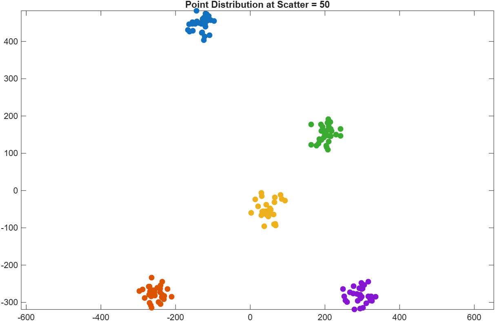
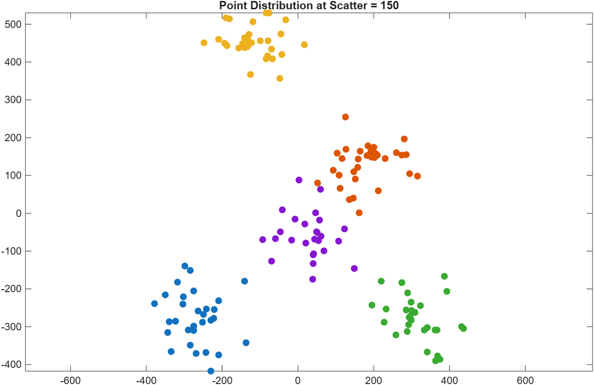
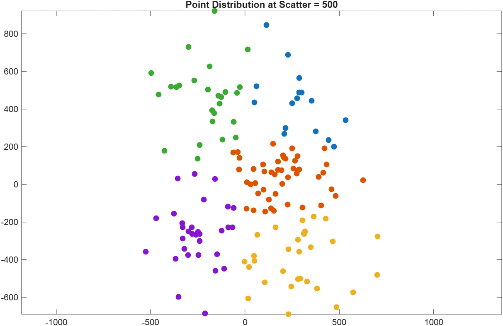
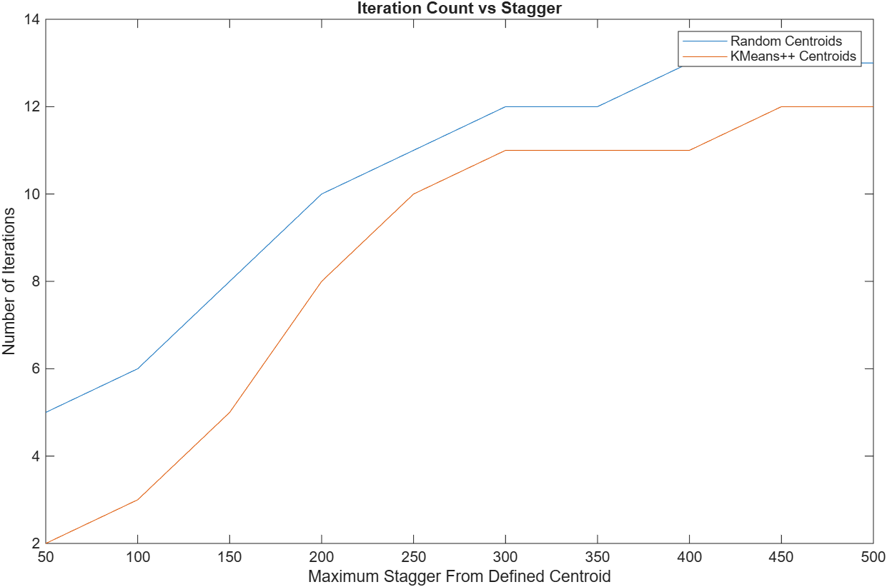
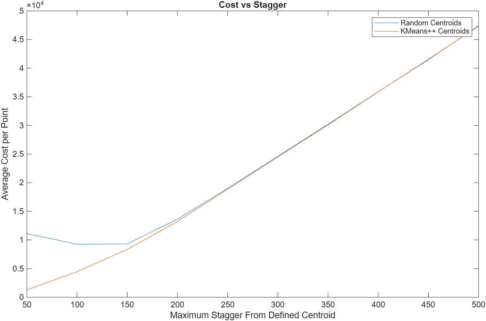

# K-Means Clustering and K-Means++

## Introduction

When working with large amounts of varied data, it can be easier to reframe the data such that similar data points are grouped together. For instance, in image compression tasks, the number of colors used to represent an image can be reduced by grouping similar colors together and assigning them the value of the average color. The task of grouping similar values together is called _clustering_, which is commonly done using the _K-Means Clustering_ algorithm.

### K-Means Clustering  

The _K-Means Clustering_ algorithm groups a set of data points into _k_ clusters, all centered around a _centroid_. The algorithm works by picking an initial set of _k_ centroids and redefining them until the total sum of squared distances between each point in a cluster and their centroid is minimized. Assuming that the initial set of centroids have already been picked (see the _K-Means++_ section for more detail), _K-Means Clustering_ follows the below algorithm:

1. Initialize _k_ empty lists, where each list represents a cluster.
2. For each data point, calculate the point's distance to each centroid. Add the data point to the cluster where its distance to the centroid is smallest.
3. For each cluster, calculate the mean coordinate on each axis. That is the new centroid for the cluster.
4. Compare the new and old centroids for the clusters. If any two are different, empty each cluster and repeat from step 2. If all centroids are the same, return these clusters.

### K-Means++

In order to start the _K-Means Clustering_ algorithm, you first need to pick a set of initial centroids. A common method for this is to pick random elements from the data and use those as the starting centroids. This approach is efficient and simple, but it's also entirely random, meaning there's no way to know how optimal the chosen centroids will be. In the worst-case scenario, this could pick _k_ points that are all very close to each other, which would require many more iterations to work. Additionally, _K-Means Clustering_ is a minimization problem that looks for a local minimum, and there's a chance that the local minimum may not be the global minimum and therefore may not be optimal. If we were able to make reliably better estimates for the initial centroids, both the runtime and the accuracy of _K-Means Clustering_ would improve.

_K-Means++_ is an algorithm that finds a much more reliable estimate of the initial centroids by ensuring all centroids picked are reasonably far from one another, based on a random threshold. It follows the below algorithm:

1. Pick one random point from the data. This is our first centroid.
2. For each data point, find the point's squared distance to the nearest centroid. Add that squared distance to a growing list, in which the index of a point's distance to the nearest centroid matches up with the index of a point in the data.
3. Find the sum of the list of each point's squared distance to the nearest centroid, and multiply that sum by a random number between 0 and 1. This is our threshold.
4. For each point's squared distance to the nearest centroid, add that value to a running sum. If the current cumulative sum is greater than or equal to the threshold, assign that point as the next centroid.
5. If the current number of centroids is less than _k_, repeat from step 2. Otherwise, if the number of centroids is equal to _k_, return the centroids.

The threshold created in step 3 allows us to pick a random point to use as a centroid more effectively. If we pick a random threshold for the cumulative squared distance to each point's nearest centroid instead of just a random index, the probability that each point is used is proportional to its distance from the nearest centroid. Therefore, a point further from all current centroids is more likely to be used. There is still an element of randomness, but it makes more separated centroids more likely, leading to more efficient and accurate outcomes.

## Methodology

### K-Means
The _K-Means_-related code I wrote is all in the `KMeans` class, in the `KMeans.kt` file. The `cluster` function performs _K-Means Clustering_, and the `pickPlusPlusCentroids` function performs _K-Means++_ centroid selection. There's also a `pickRandomCentroids` function for random initial centroid selection, a `calculateCost` function to determine the total cost of clustering, and a few helper functions for different parts of the algorithm.

When clustering, the goal is to have all points in a cluster as close together as possible. As such, when points are further away from the centroid, the centroids are less accurate, and we're losing more data. That data lost is referred to as the _cost_. The _cost_ is measured as the sum of the squared distances between each point and its centroid, or $cost=\displaystyle\sum_{i=1}^k\sum_{x\in S_i}||x-\mu_i||^2$ for $k$ clusters in a list of clusters $S$. In the function, I divide this by the number of points to get the average cost per point, so that clusters of data with different numbers of points are comparable with the same metric. In total, the cost function determines $\frac{1}{N}\displaystyle\sum_{i=1}^k\sum_{x\in S_i}||x-\mu_i||^2$.

I also wrote a few unit tests for public functionalities of the `KMeans` class. For the centroid-picking functions, I tested that both functions return the expected number of centroids, and that all centroids picked are from the original data. I also tested that the cost calculation returns the expected values for. Lastly, I checked that the clustering itself returns both the correct number of clusters, and that no points were created or left out by clustering. It's impossible to check everything due to the randomness inherent to the algorithm, but I was able to check that some basic functionalities worked as expected.

### Data Generation
50 Scatter  |  100 Scatter  |  500 Scatter
:----------:|:-------------:|:-------------:
  |    |  

___Figure 1:___ _Three plots showing data generated at increasing stagger values with 30 points per generated cluster. As scatter increases, the points get further away from their centers and the clusters become less well-defined. The colors show the different clusters, as identified by the clustering function._

To test both algorithms, we first need data. Instead of finding real-world data, I used a more generalizable approach: generating random data based on a few inputs. Using a constant set of initial centers, I created a function to generate random points around those centers. This creates artificial clusters of varying strength. The number of points per cluster is specified with one parameter, and the stagger is specified by another parameter. The stagger is the maximum euclidean distance a point can be from the center of the cluster, so as the stagger increases, the clusters become less well-defined (see Fig. 1). The scatterplot visualizations were generated in `visualize_clusters.m`. This allows us to test the functionality of the algorithms over both well-defined clusters and less clustered data.

## Results and Discussion
In theory, using _K-Means++_ centroid selection should make the clustering algorithm both more efficient and more accurate. However, the efficiency and accuracy are likely to vary as the clusters become less well-defined. So, using the data, I compared the runtimes and costs of clustering with random centroids and with _K-Means++_ centroids. For each attempt, I found the average over a large number of runs to reduce noise in the data. All of the plots were created in the `plot_data.m` file.

### Runtime

___Figure 2:___ _This shows the number of iterations required for K-Means Clustering as the stagger increases and the clusters get less defined. Both increase in runtime as stagger increases, but the K-Means++ approach consistently requires fewer iterations._

_K-Means Clustering_ is an iterative minimization algorithm, and the number of iterations it takes varies from attempt to attempt. It will keep iterating until it achieves a local minimum; there is no set stopping point. Therefore, we can measure the runtime by the number of iterations. As is shown in Fig. 2, the number of iterations generally increases as the clusters become less defined. When it's harder to define the boundaries of a cluster, the algorithm takes longer to find those boundaries and more iterations to refine the centroids. However, when the initial centroids are further from each other, they are more likely to be close to the optimal centroids, so it will take fewer iterations to refine them. This explains why the _K-Means++_ approach takes noticeably fewer iterations, especially with more well-defined clusters.

The _K-Means++_ approach remains faster up to 500 scatter, when the clusters are not well-defined at all (see Fig. 1). However, when the clusters are very close at small scatter values, the different is much more significant. _K-Means++_ will very often give better estimates than the random approach because of how far apart the guesses consistently are, and when the clusters are very well-defined, those selected centroids tend to be points within those different clusters, so very little change needs to be made for a local minimum to be reached. This is true to some extent for larger stagger values too, but especially so for smaller stagger values. While the centroid selection process for _K-Means++_ does take a bit longer than the process for random selection, for much larger datasets, the reduced iteration count will become invaluable in reducing time compared to the slight extra time spent on finding those iniital centroids.

### Accuracy

___Figure 3:___ _This shows the average cost of clustering per point as the stagger value increases for both random centroids and K-Means++ centroids. Both increase linearly and are very similar afrer 200 stagger, but K-Means++ has lower cost at lower scatter values._

As described in methodology, average cost is calculated as $\frac{1}{N}\displaystyle\sum_{i=1}^k\sum_{x\in S_i}||x-\mu_i||^2$. When the centroids are very close to the points in their clusters, this will be small; but when the centroids are much further from the points in their clusters, this will be much larger. This is apparent from the experimental data (see Fig. 3), which shows a mostly linear increase for both centroid-picking approaches as the stagger increases and the clusters become less defined. After a stagger size of 200 or above, there isn't much of a difference, but the difference is clear at lower stagger values.

When the points are clustered closely together due to lower stagger values, the optimal solutions are often obvious to human eyes. However, to a computer running the _K-Means Clustering_ algorithm, it's easier to get pulled into a local minimum that isn't the global minimum. In other words, with a bad set of initial centroids, it's easier to fall into a sub-optimal solution when the clusters are more well-defined. Because of this, the randomly-selected centroids lead to a greater average cost than the  _K-Means++_ approach. The _K-Means++_ generally follows the linear pattern, implying that it much more consistently finds the optimal solution, while the random approach is noticeably less consistent. When the clusters are less well-defined, it's harder to find a local minimum that isn't the global minimum since the points are mostly evenly spaced. However, when the clusters are well-defined, _K-Means++_ is the clear winner.

## Conclusion

_K-Means Clustering_ is an iterative approach to data classification that is simpler than many of its alternative and is generally reliable, but it is also prone to error and time-consuming when approached in the wrong way. It is largely dependent on the initial centroids picked, and _K-Means++_ is a popular improvement on the random-selection approach. When the initial centroids are reliably further away from one another, it's reasonable to expect faster runtime and more reliably accurate results, especially when the clusters are well-defined.

The _K-Means++_ approach very consistently requires fewer iterations to get to a solution, regardless of how well-defined the clusters are. Additionally, when the clusters are well-defined, the accuracy of the _K-Means++_ approach is noticeably better than the random approach to centroid selection. This happens because the _K-Means++_ approach selects centroids further away from each other, which puts them often much closer to the optimal solution. Therefore, it takes fewer iterations to get to the optimal solution, and it gets there as opposed to some other local minimum much more reliably. There's always a chance for error, but _K-Means++_ decreases that significantly. Even if centroid selection for _K-Means++_ does take a bit more time than random selection, it leads to not only significant runtime decreases for the larger _K-Means Clustering_ algorithm, but it also more reliably provides optimal solutions. With a proper implementation, there's very little reason not to use _K-Means++_ to prepare for _K-Means Clustering_ tasks.